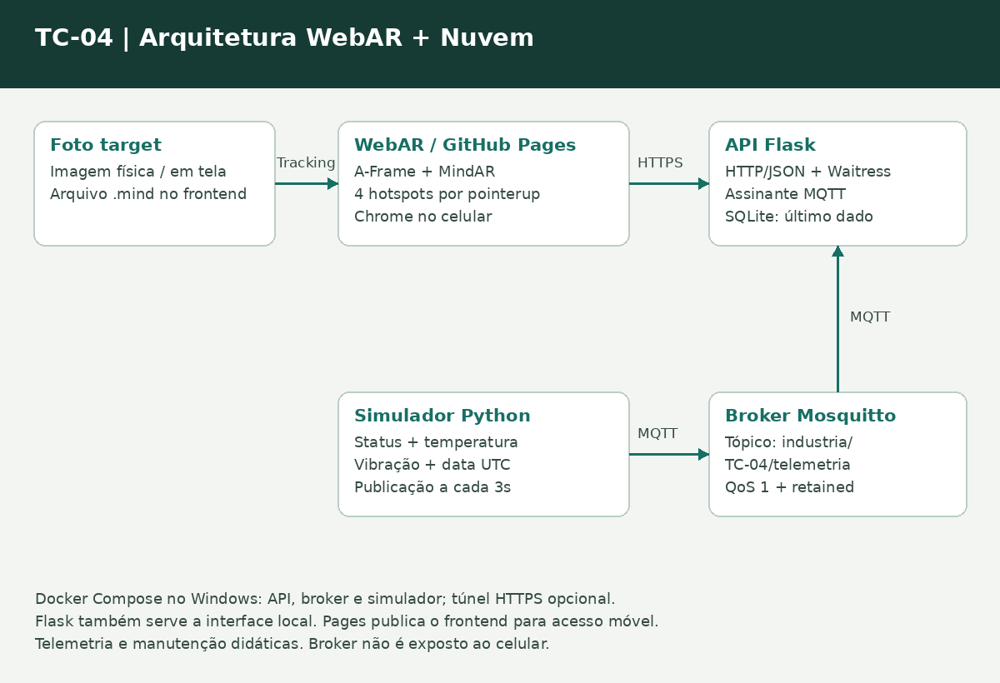

# Torno Convencional 04 - WebAR, Flask e MQTT

**Tema:** 4 - Torno Convencional.  
**Integrantes:** Eduardo Duran Teodoro e Felipe Mazzi.

Protótipo de apoio à manutenção com quatro hotspots em RA, API Flask, telemetria simulada por MQTT e serviços executados pelo Docker Compose. A foto enviada identifica visualmente um **ROMI TORMAX 30A**; não houve levantamento presencial de série, ano, capacidades ou estado real.

Status, temperatura, vibração e manutenção são **didáticos**. Não representam limites de segurança ou parâmetros oficiais dessa máquina.

## Estrutura

| Arquivo/pasta | Conteúdo |
|---|---|
| frontend/index.html | WebAR completa: HTML, CSS e JavaScript |
| frontend/target.png | Foto de reconhecimento |
| frontend/target.mind | Target já compilado com MindAR 1.2.5 |
| backend/app.py | API Flask, assinante MQTT, SQLite e frontend local |
| simulator/simulator.py | Publicador dos dados fictícios |
| mqtt/mosquitto.conf | Configuração do broker |
| Dockerfile | Uma imagem compartilhada pela API e pelo simulador |
| compose.yaml | Broker, API e simulador; túnel HTTPS opcional |
| requirements.txt | Bibliotecas Python |
| docs/arquitetura.png | Diagrama da solução |
| .github/workflows/pages.yml | Publicação apenas do frontend no Pages |
| .gitignore | Exclui arquivos locais gerados |
| README.md | Planejamento, execução, análise e testes |


## 1. Preparar o Windows

1. Instale e abra **Docker Desktop**, com containers Linux/WSL 2 habilitados. Aguarde o mecanismo iniciar.
2. Extraia o ZIP e entre na pasta deste README.
3. Na barra de endereço do Explorador, digite `powershell` e pressione Enter.
4. Confira o Docker:

```powershell
docker --version
docker compose version
```

5. Inicie os serviços:

```powershell
docker compose up --build -d
```

## 2. Conferir os serviços e a API

```powershell
docker compose ps
docker compose logs -f api simulator
```

Espere aparecer conexão MQTT e publicações do simulador. **Ctrl+C** encerra só o acompanhamento dos logs; os containers continuam ativos.

Abra no navegador do PC:

- **http://localhost:5000**: interface WebAR.
- **http://localhost:5000/health**: estado HTTP e MQTT.
- **http://localhost:5000/api/equipamentos/TC-04**: identificação e manutenção.
- **http://localhost:5000/api/equipamentos/TC-04/telemetria**: status, temperatura e vibração.

Na página, salve `http://localhost:5000` como endereço da API e clique **Consultar API sem câmera**. Confira a leitura antes de iniciar a RA. Esse modo é diagnóstico e não substitui a apresentação com tracking.


## 5. Conectar a API HTTPS ao Celular

Com os serviços ainda ativos, execute:

```powershell
docker compose --profile https up -d tunnel
docker compose logs -f tunnel
```

1. Copie a URL **https://...trycloudflare.com** que aparecer nos logs.
2. No telefone, abra essa URL com `/health` no final e confira o JSON.
3. Abra a URL HTTPS do WebAR no GitHub Pages.
4. Cole **somente a URL base do túnel**, sem /health, no campo da API e toque **Salvar API**.
5. Toque **Consultar API sem câmera** e confira os dados.

O PC deve estar ligado, os serviços ativos e o túnel disponível. A URL é temporária e muda se o container do túnel for recriado. Para gerar outra sessão:

```powershell
docker compose --profile https up -d --force-recreate tunnel
```

Uma URL localhost no celular apontaria para o próprio celular. Também não use API HTTP em uma página HTTPS: o navegador a bloquearia. O túnel acessa apenas a API; o broker não é exposto ao celular.

## 6. Reconhecer o target e usar a RA

1. No PC, abra a foto pelo link **Abrir target para imprimir ou exibir**, na interface, ou abra `frontend/target.png` diretamente. Se imprimir, mantenha a foto inteira, sem recorte ou espelhamento.
2. No Celular, toque **Iniciar realidade aumentada** e permita a câmera.
3. Aponte para a foto completa em outra tela ou impressa. Use boa iluminação, pouco reflexo e movimento lento. A foto deve caber na área da câmera.
4. Espere **RA ATIVA** e toque nos quatro pontos:

| Ponto | Região | Informação |
|---|---|---|
| 1 | Cabeçote | Função técnica local e identificação via API |
| 2 | Carro | Função técnica local e monitoramento via API |
| 3 | Contraponto | Função e orientação geral locais |
| 4 | Área de proteção | Orientação geral e manutenção via API |

O ponto 4 corresponde à região de trabalho junto à placa; a foto não comprova a presença ou adequação de todas as proteções. Este protótipo não certifica segurança do equipamento.

Aponte para **esta foto**, não para qualquer torno parecido. O .mind contém descritores dessa imagem exata, já compilada. Ao perder o target, pontos e painel são ocultados. Toque **Sair da RA** para voltar à tela inicial.

## 7. Demonstrar uma atualização MQTT conhecida

O simulador publica novas amostras a cada 3s. Para demonstrar um valor fixado sem ele ser sobrescrito, pare primeiro o simulador:

```powershell
docker compose stop simulator
```

Depois, copie estes comandos no PowerShell:

```powershell
$dados = @{
    id = "TC-04"
    temperatura = 42.7
    vibracao = 1.9
    status = "operando"
    atualizacao = [DateTime]::UtcNow.ToString("o")
    simulado = $true
} | ConvertTo-Json -Compress
$dados | docker compose exec -T mqtt mosquitto_pub -h localhost -t industria/TC-04/telemetria -q 1 -r -s
```

No ponto 2 da RA, toque **Consultar novamente** e confira **42,7 °C** e **1,9 mm/s**. `-s` envia o JSON pelo stdin, evitando problemas de aspas no PowerShell.

## 8. Demonstrar falha e recuperação da API

Com a página RA já aberta:

```powershell
docker compose stop api
```

Toque **Consultar novamente** no ponto 2. A interface deve informar que não foi possível consultar o equipamento. Câmera, tracking e conteúdo estático continuam no navegador, inclusive se a página local havia sido carregada pela API; não recarregue a página local enquanto ela estiver parada.

Restaure os serviços:

```powershell
docker compose start api
docker compose start simulator
```

Aguarde alguns segundos e consulte de novo. O último dado fica no SQLite do volume api_data; o broker também guarda a publicação retida. Caso o broker pare, a API mantém o dado anterior, informa conexão/idade e tenta reconectar. Sem primeira amostra, telemetria retorna 503.

## 9. Encerrar e executar novamente

```powershell
docker compose --profile https down
```

Esse comando encerra os serviços e o túnel, mas preserva volumes. Na próxima vez, execute `docker compose up -d`; só use `--build` se alterou o código Python. Se reiniciar a demonstração pelo celular, inicie novamente o túnel e confirme sua URL.

Para verificar mudanças nos arquivos Python após editar:

```powershell
docker compose up --build -d
```

`docker compose down -v` apaga os dados persistidos; só use se quiser zerar a demonstração.

## 10. Planejamento e arquitetura



Ativo lógico **TC-04**, em contexto didático de usinagem. As quatro regiões escolhidas são cabeçote, carro, contraponto e área de proteção. A foto recebida é o target; o cadastro, o status e a manutenção são centralizados na API.

**Decisão 1:** nomes, funções e orientações gerais dos componentes permanecem no frontend para estarem acessíveis mesmo com API indisponível. **Decisão 2:** status, temperatura, vibração e atualização pertencem ao serviço porque mudam e precisam refletir mensagens MQTT. A manutenção didática também fica no backend, sem necessidade de republicar a interface para editar seu conteúdo.

MindAR/A-Frame emitem targetFound/targetLost. As âncoras 3D são filhas do target; suas posições são projetadas para a tela a cada frame. Os botões HTML acompanham essas posições. O toque usa pointerup; os dados dinâmicos são obtidos por fetch HTTP/JSON, com timeout e mensagem de falha. Não há valores fixos de monitoramento no frontend.

O tópico JSON `industria/TC-04/telemetria` mantém status, temperatura e vibração na mesma amostra. Isso é equivalente ao exemplo de tópicos separados do enunciado. QoS 1 e retained permitem entregar/reter a última amostra; duplicações são toleradas porque a API substitui o estado mais recente. O timestamp original impede que uma publicação antiga retida seja tratada como recente.

| Serviço | Porta | Dependências |
|---|---|---|
| mqtt | 1883, só na rede interna | Nenhuma |
| api | 5000 no PC | Broker saudável |
| simulator | Sem porta HTTP | Broker e API saudáveis |
| tunnel, opcional | Conexões de saída HTTPS | API saudável |

A API também fornece o frontend **local** para dispensar um container Nginx. Na publicação, Pages fornece o frontend de forma independente da API. O Dockerfile compartilhado empacota Python e dependências; Compose cria containers separados com comandos distintos. Containers reduzem diferenças entre máquinas, isolam processos e tornam a execução reproduzível; não garantem por si só disponibilidade ou segurança de produção.

## 11. IaaS, PaaS e SaaS

| Cenário | Modelo | Responsabilidades |
|---|---|---|
| Empresa contrata VM Linux e instala Docker/Flask/MQTT | IaaS | Provedor administra infraestrutura física/virtualização; empresa administra SO, aplicações, broker, configurações, acesso, dados e backups |
| Equipe envia aplicação para plataforma que administra infraestrutura/runtime | PaaS | Provedor administra infraestrutura e ambiente conforme contrato; equipe mantém código, configuração, dados e integração com broker/armazenamento compatíveis |
| Técnico usa aplicação pronta no navegador | SaaS na perspectiva do usuário | Fornecedor opera o software e sua infraestrutura; consumidor utiliza a solução e administra usuários/dados conforme contrato |

Docker Desktop local não é, sozinho, uma contratação de nuvem. O túnel dá acesso HTTPS ao PC, mas não transforma a API em serviço permanente. Uma implantação estável poderia usar VM com proxy HTTPS ou plataforma compatível com MQTT e armazenamento durável. Para muitos usuários, escalar a API exigiria separar o consumidor MQTT e usar estado compartilhado; replicar este SQLite em vários containers não resolveria essa necessidade.

## 12. Matriz de testes e critérios

| ID | Teste | Resultado da revisão em navegador |
|---|---|---|
| T01 | Abrir câmera WebAR | Fluxo de vídeo disponível |
| T02 | Apontar para target | MindAR reconheceu a foto com o .mind real |
| T03 | Movimentar target | Hotspots acompanharam o deslocamento da imagem no vídeo |
| T04 | Tocar hotspot técnico | Painel apresentou a descrição do componente |
| T05 | Consultar monitoramento | API devolveu JSON exibido pelo frontend |
| T06 | Publicar valor por MQTT | Mensagem real em broker local atualizou a API |
| T07 | Consultar novamente | Valor publicado apareceu no painel |
| T08 | Interromper API | Mensagem de indisponibilidade; RA permaneceu ativa |
| T09 | Restaurar API | Consulta recuperou o dado |

Os RF01–RF09 estão cobertos pelo target, tracking, quatro pontos, informação ao toque, API, status + dois sensores, MQTT, nova consulta e falha tratada. **RF10:** Compose configura os serviços exigidos.
